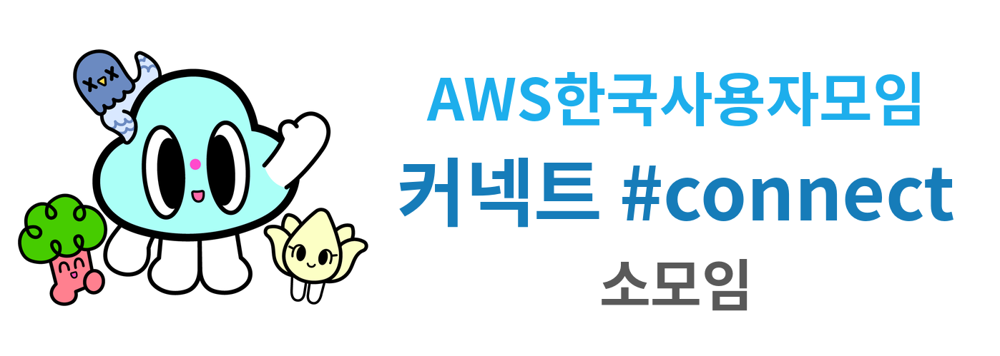

<!-- markdownlint-disable-file -->
# AWSKRUG 커넥트 #connect 소모임

- since 2026.10
- [AWSKRUG Facebook Link](https://www.facebook.com/groups/awskrug/)
- [AWSKRUG Meetup Link](https://www.meetup.com/ko-KR/awskrug/)
- [AWSKRUG Web Site](http://www.awskr.org/)
- [AWSKRUG Slack Channel Link](http://awskrug.slack.com)

> 이 모임은 2017년부터 이어진 AWSKRUG 구디(구로디지털) 모임이 **'AWSKRUG 커넥트 #connect 소모임'**으로 이름을 바꿔 새롭게 시작하는 모임입니다.
> 회차는 커넥트로 1st부터 새로 시작하며, 구디 시절(1st ~ 70th)의 기록은 [gudi-group](https://github.com/awskrug/gudi-group)에서 볼 수 있습니다.

# 모임 소개
AWS와 관련된 주제라면 무엇이든 자유롭게 나누는 모임입니다.

취준생, 사회 초년생부터 실무 경험이 풍부한 분들까지 함께 어우러져, 사람과 사람, 경험과 경험이 연결되는 네트워킹 중심의 모임을 지향합니다.

# 모임 일시
  - 아래 세 곳을 번갈아 가며 진행합니다
    - 센터필드
    - 강남 스파크플러스
    - 여의도 스파크플러스
  - 정확한 일정과 장소는 매 회차 Meetup과 Slack #connect 채널에 공지합니다

# 발표자 보상
  - AWSKRUG모임에서 발표를 하시는 분들은 AWS 크레딧을 드리니 많이 발표지원 해주세요~ (크레딧 금액은 사정상 달라질 수 있음)
  - [발표에 대한 부담감에 대해서](https://github.com/awskrug/connect-group/issues/1)

# Meetups

## 2026년

(첫 밋업이 확정되면 `1st meetup`을 이 아래에 추가해 주세요)
